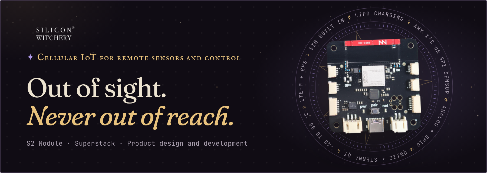

The S2 is an LTE-M IoT board with the SIM and prepaid data built in. Wire up sensors or relays, write a few lines of Lua, and the S2 sends readings to your own API and acts on your commands. Once it's bolted to the equipment, you still change its code and watch its log from your desk.

**[Order an S2 ↗](https://www.digikey.com/short/m3tvm97v)** · [Watch the 40s demo](https://www.siliconwitchery.com/#demo) · [Read the docs](https://docs.siliconwitchery.com)

<sub>No monthly fees · €10 of starter credit in the box · then €1 per MB</sub>

### ✦ Get started

Install the Superstack CLI on macOS and log in:

```sh
brew install --cask siliconwitchery/tap/superstack
superstack login github
```

The [superstack-cli](https://github.com/siliconwitchery/superstack-cli#install) README covers Windows, Linux and Nix.

Teach Claude Code to write S2 Lua and drive the CLI:

```
/plugin marketplace add siliconwitchery/superstack-agent-plugins
/plugin install superstack@siliconwitchery
```

### ✦ Your IoT product, from idea to factory

Silicon Witchery designs IoT devices, with LTE-M cellular and Bluetooth at its core. We take your product from the first schematic to final testing at the lab, down to the antenna, firmware and power budget.

**[Book a call ↗](https://cal.com/siliconwitchery/30min)**

<sub>No dark patterns. Only dark magic.</sub>
